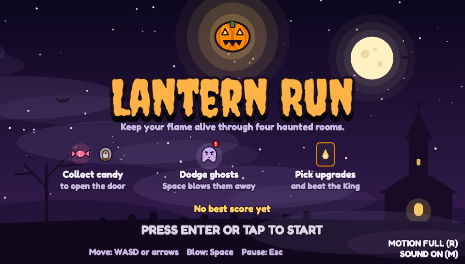
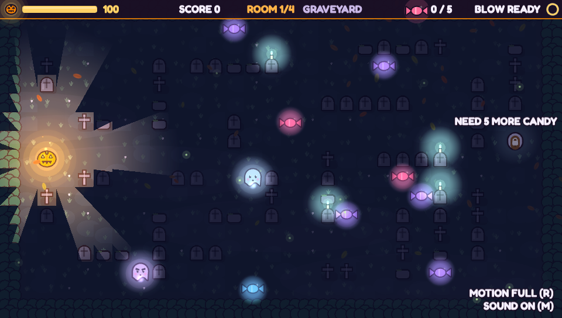
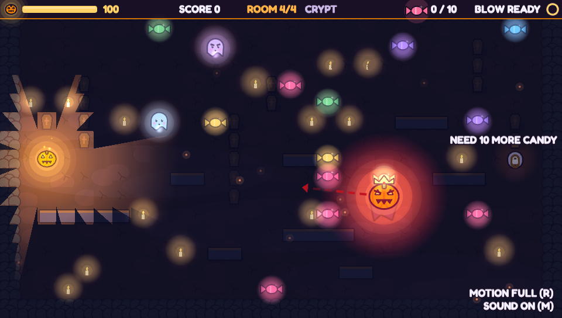
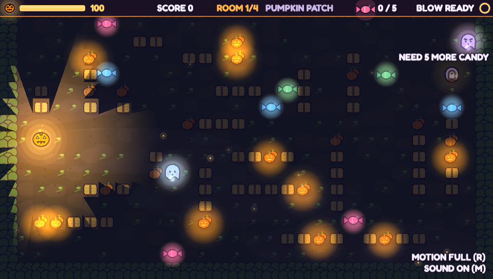
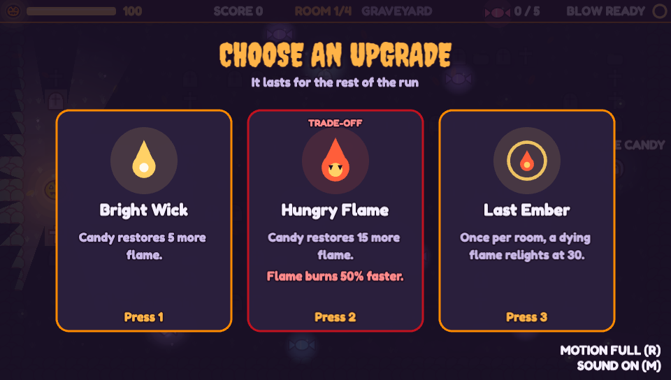

# Lantern Run

A Halloween roguelike for [Kiroween 2026](https://kiroween.devpost.com/). You are a jack-o'-lantern carrying a flame through four rooms. Collect candy to meet each room's goal, dodge ghosts, pick an upgrade after each trial room, and defeat the Pumpkin King to win. Losing the flame ends the run.

## Play

- Live build: https://hyy12345678.github.io/lantern-run/
- Works in the browser with no login and no network calls at runtime.



| Headstones cast shadows from the lantern | The Pumpkin King winds up a dash in a candle-lit crypt |
|---|---|
|  |  |
| **Carved pumpkins light the patch** | **Upgrades, with a trade-off card** |
|  |  |

## Run locally

Requires Node.js 20 or newer.

```bash
npm install
npm run dev        # local dev server
npm run typecheck  # TypeScript check
npm run test       # Vitest + fast-check property tests
npm run build      # production build into dist/
```

Dev aids, for testing and screenshots only:

- `?scene=RunScene` opens a run directly. `&seed=N&room=R` starts in room R of seed N.
- `?choose=1` opens the upgrade cards at once. `?pause=1` starts paused.
- `&freeze=1` stops the room from advancing. `&bossPhase=windup` (room 4) shows the Pumpkin King about to dash.
- `&nobanner=1` skips the opening wipe, the room banner, and the boss intro. `&flame=N` sets the starting flame. `&atDoor=1` starts at the door with the goal met. `&fps=1` shows the frame rate.
- `?touch=1` shows the touch controls on a desktop.

## Controls

| Action | Keyboard | Touch |
|---|---|---|
| Move | Arrows / WASD | Joystick (bottom left) |
| Blow (push ghosts away) | Space | Blow button (bottom right) |
| Choose upgrade | 1, 2, 3 or click a card | Tap a card |
| Pause / resume | Esc or P | Pauses automatically when the tab is hidden |
| Quit to menu (while paused) | Q | |
| Sound on/off | M or click the label | Tap the label |
| Reduced motion on/off | R or click the label | Tap the label |

## Run structure

- Four rooms: three trial rooms (Graveyard, Chapel, Pumpkin Patch, each once per run in a random order) and the boss room (Crypt).
- The rooms are dark. Your lantern lights the way, walls cast shadows, and the light shrinks as the flame burns down.
- Each room has its own lights: spirit candles in the graveyard, stained glass in the chapel, carved pumpkins in the patch, and candles in the crypt.
- A run opens and moves between rooms with a circle wipe around the pumpkin. The boss room opens with an intro, and losing ends with the flame going out in a puff of smoke.
- Each room starts with the flame at 100. The room is cleared by collecting its candy goal and reaching the door.
- Chase ghosts find their way around walls. Blink ghosts fade out just before they teleport.
- The Pumpkin King chases you, stops to wind up, and dashes along a red warning line. Step aside.
- After each trial room, pick one of three upgrades from a pool of eight. Hungry Flame is a trade-off: more flame from candy, but it burns faster. Last Ember relights a dying flame once per room.
- The best score is saved in the browser's local storage.

## Accessibility

- Reduced motion follows your browser's `prefers-reduced-motion` setting and can be toggled in the menu and while paused. It turns off camera shake, bobbing, flicker, fog drift, fireflies, embers, wisps, leaves, and the menu intro, and swaps the circle wipe for a fade.
- HUD text is at least 18 px at the base size. Hits pulse the screen edges instead of flashing the whole screen.

## How Kiro was used

The project was built in Kiro with a spec-driven workflow:

- **Spec:** `.kiro/specs/lantern-run/` holds `requirements.md` (15 requirement groups with acceptance criteria), `design.md` (modules, data types, tuning values, test plan), and `tasks.md` (the implementation plan with status). The spec was rewritten once when the game changed from three nights to a roguelike, and the task list tracks that change.
- **Steering:** `.kiro/steering/` holds `product.md` (scope rules and judging priorities), `tech.md` (stack and code rules, such as keeping `src/core/` free of Phaser imports and requiring a seeded RNG), and `style-guide.md` (palette, motion limits, HUD layout).
- **Hooks:** `.kiro/hooks/` runs the TypeScript check on every `.ts` save, and runs the test suite after each spec task.
- **Property-based tests:** `tests/` uses fast-check to check rules such as flame bounds, deterministic level generation, ghost movement, and blow behavior. They run after each change to the core logic.

### What worked and what didn't

I mainly used Kiro's Specs, Steering, and Hooks throughout development.

**What worked well:**

- **Specs** helped me break the game into manageable tasks and keep track of progress.
- **Steering** kept the code structure and visual style consistent, especially when adding new features.
- **Hooks** automated TypeScript checks and tests, reducing repetitive manual work.
- **Property-based tests** helped verify core game rules and deterministic behavior.

**What could be improved:**

- When the game changed from a three-night structure to a roguelike, I had to rewrite parts of the spec and reorganize the task list. Keeping everything in sync took extra effort.
- Automated tests were useful for game logic, but they couldn't tell whether the gameplay was actually fun or well-balanced. That still required manual playtesting.

**Overall**, Kiro was most useful for keeping development organized and catching issues early. It didn't eliminate the need for manual testing or design decisions, but it made the development process more structured and easier to manage.

## License

MIT. See [LICENSE](LICENSE). Third-party assets are listed in [public/assets/CREDITS.md](public/assets/CREDITS.md). Sound effects are synthesized in code and use no audio files.
